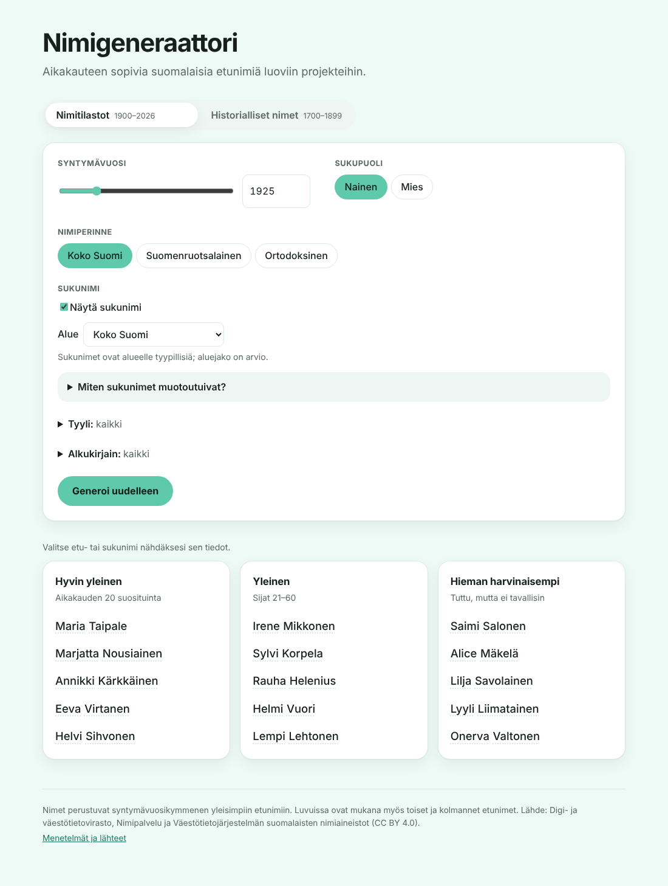
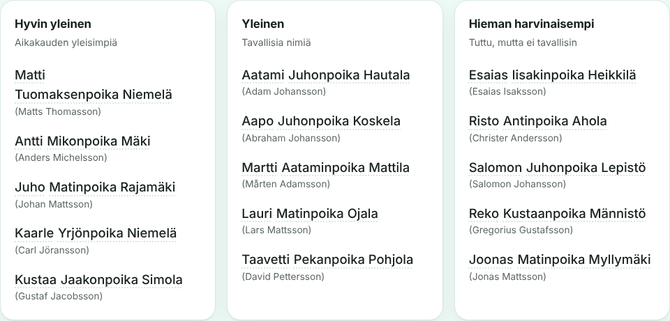
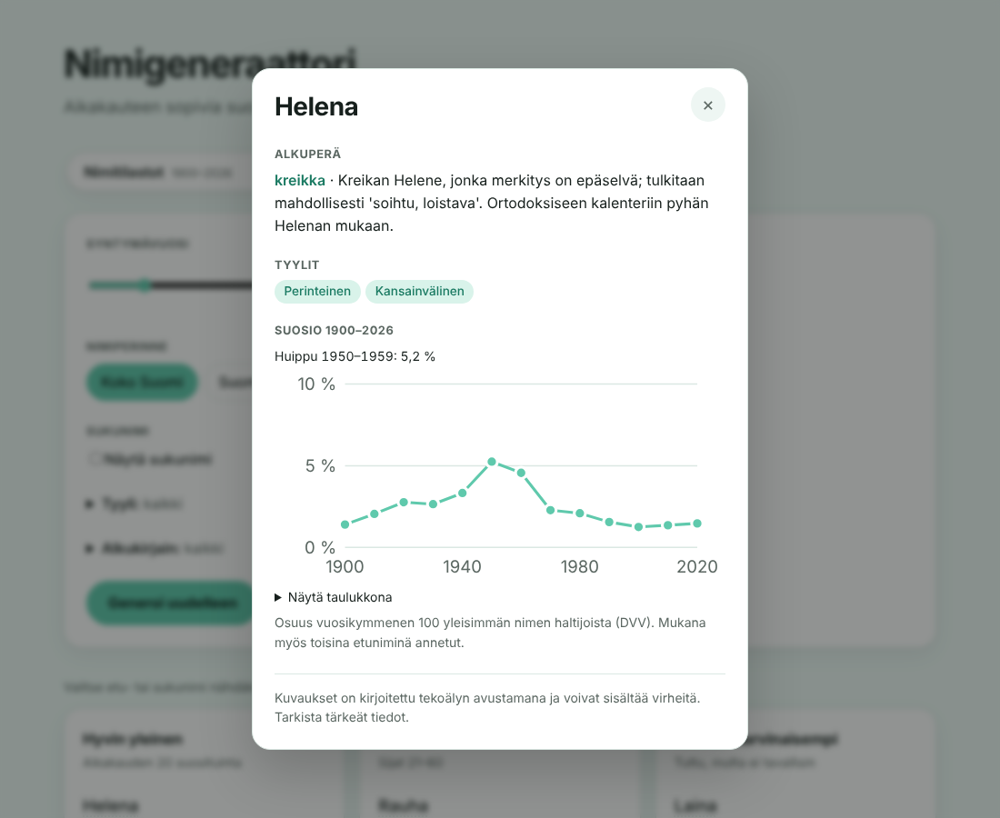

# nimigeneraattori

Nimigeneraattori luoviin projekteihin, kuten kirjojen ja pelien hahmoille. Valitse syntymävuosi, niin sivu ehdottaa aikakauteen sopivia suomalaisia nimiä kolmessa kategoriassa: **hyvin yleinen**, **yleinen** ja **hieman harvinaisempi**.

**Sivusto: https://lylled.github.io/nimigeneraattori/**



## Ominaisuudet

- **Kaksi aineistoa:** *Nimitilastot* 1900–2026 perustuu DVV:n dataan, *Historialliset nimet* 1700–1899 käsin koottuihin arvioihin.
- **Nimiperinteet:** koko Suomi, suomenruotsalainen tai ortodoksinen.
- **Sukunimet** alueen ja aikakauden mukaan. Ennen 1880-lukua länsisuomalainen hahmo saa isännimen ja talonnimen, ja suluissa näkyy kirkonkirjoihin kirjattu ruotsalainen muoto.
- **Suodattimet:** tyyli (luonto, raamatullinen, kansallisromanttinen, hyve- ja tunne, perinteinen, säätyläinen, kansainvälinen) ja alkukirjain.
- **Nimikortit:** etunimen alkuperä, tyylit ja suosiokäyrä 1900–2026; sukunimen tyyppi, tausta ja tyypillinen alue.
- **Jaettava linkki:** hakuasetukset tallentuvat osoitteeseen.
- **[Menetelmät ja lähteet](https://lylled.github.io/nimigeneraattori/#menetelmat)** -sivu kertoo, mistä nimet tulevat ja mihin tuloksiin voi luottaa.





## Arkkitehtuuri

Sivu on staattinen: kaikki data on valmiina selaimessa, eikä taustapalvelua tarvita.

```
data/        käsin kerätyt listat, arviot ja merkinnät (CSV, TSV, TXT)
   │  scripts/*.py: jäsennys, korjaukset ja tarkistukset (Python, unittest)
   ▼
src/data/    selaimen aineisto (JSON)
   │
   ▼
src/lib/     generointilogiikka puhtaina funktioina (TypeScript, Vitest)
   │           generator.ts   jaksojen painotus, luokittelu ja arvonta
   │           sukunimet.ts   isännimet, talonnimet ja sukunimet
   │           tyylit.ts, nimitiedot.ts, url.ts
   ▼
src/*.tsx    käyttöliittymä (React)
   │
   ▼
GitHub Actions → GitHub Pages
```

- **Tekoäly datan rakennusvaiheessa:** tyylimerkinnät, nimien kuvaukset ja historialliset arviot on tehty tekoälyn avustamana tekstitiedostoihin, joita voi korjata käsin. Sivun käytön aikana tekoälyä ei käytetä.
- **Suorituskyky:** nimikortit, sukunimet ja metodologiasivu ladataan vasta tarvittaessa. Lighthouse: suorituskyky 99, saavutettavuus, parhaat käytännöt ja SEO 100.
- **Toistettavuus:** arvonta käyttää siemenlukua, joten testit ovat deterministisiä.

## Kehitys

Vaatii Node.js 22:n ja Python 3:n.

```sh
npm install
npm run dev          # kehityspalvelin
npm run build        # tuotantoversio hakemistoon dist/
npm test             # Vitest
npm run lint         # oxlint
npm run format       # Prettier
```

`main`-haaraan pushattu koodi julkaistaan automaattisesti GitHub Pagesiin (`.github/workflows/deploy.yml`).

## Data

Nimidata kootaan Python-skripteillä hakemistossa `scripts/`:

```sh
python3 scripts/parse_nimipalvelu.py   # käsin kopioidut top 100 -listat → CSV
python3 scripts/first_name_share.py    # ensimmäisen nimen osuudet (avoindata.fi)
python3 scripts/build_decades.py       # yhdistetty ja korjattu taulukko
python3 scripts/build_names_json.py    # selaimen data src/data/names.json
python3 scripts/build_historical_json.py  # arviot → src/data/historical.json, suomenruotsalainen.json, ortodoksinen.json
python3 scripts/build_styles_json.py   # nimityylit → src/data/styles.json
python3 scripts/build_info_json.py     # nimien kuvaukset → src/data/info.json
python3 scripts/build_surnames_json.py # sukunimet → src/data/surnames.json
python3 -m unittest discover -s scripts -p 'test_*.py'
```

| Aineisto | Lähdetiedosto |
|---|---|
| Historialliset arviot | `data/historical/arviot.txt` |
| Nimiperinteet ja niiden lähteet | `data/traditions/*.txt` |
| Nimityylit | `data/styles/tyylit.csv`, määritelmät [`docs/tyylit.md`](docs/tyylit.md) |
| Etunimien kuvaukset | `data/info/kuvaukset.tsv` |
| Sukunimet | `data/surnames/sukunimet.tsv` |

Datalähteet, niiden rajoitteet ja korjaukset on kuvattu tiedostossa [`docs/data-sources.md`](docs/data-sources.md) ja datan rakenne sekä generointi tiedostossa [`docs/data-schema.md`](docs/data-schema.md). Työlista on tiedostossa [`BACKLOG.md`](BACKLOG.md) ja GitHubin issueissa.

## Lähteet

Lähde: Digi- ja väestötietovirasto, Nimipalvelu ja Väestötietojärjestelmän suomalaisten nimiaineistot (CC BY 4.0).
